  <b>AI / ML engineer</b> studying computer science at the University of Toronto. 
  I train models, then build the systems that put them in people's hands.

### ⚡ right now

- 🧠 **CSC485**: training neural dependency parsers in PyTorch
- 🛰️ **on the side**: model serving, inference routing, and LLM agents

## 🗺️ the course map

## 🧪 the ml lab

## ⚙️ systems & tools

## 🧰 stack

<!--
  Every image above is generated from data/profile.json.
  Edit that file (add a course, swap a project) and push: the workflow in
  .github/workflows/build.yml re-renders assets/. Locally: node scripts/build.mjs
-->
